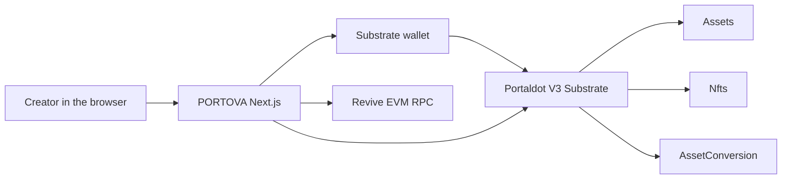

# PORTOVA

PORTOVA is a non-custodial creator app for the Portaldot V3 testnet. A person can create a fungible token, launch an NFT collection, open a pool, add and remove liquidity, and swap, with every balance and quote read from the chain. The app does not hold a key and does not ask for a seed phrase.

Live app: https://portova.vercel.app

Repository: https://github.com/siyaind/portova

Track: Ecosystem DApps, Portaldot Hacker House 2026.

## Network

| | |
|---|---|
| Chain | Portaldot V3 testnet |
| Spec | `portaldot-v3` |
| Substrate | `wss://test-node-v3.portaldot.dev` |
| EVM | `https://test-evm-rpc-v3.portaldot.dev` |
| EVM chain id | `420420777` |
| Native asset | tPOT, 14 Substrate decimals, SS58 prefix 42 |
| Node console | https://node-console.portaldot.dev |

There is no required environment file. Those endpoints are the defaults in `lib/network.ts`. This build does not talk to any other chain.

## What is on chain

Signing uses a Substrate wallet through Polkadot.js, Talisman, SubWallet, or another compatible extension. The signed calls use the runtime pallets, not a contract deployed by this project.

| Action | Pallet |
|---|---|
| Create a token, set metadata, mint supply | `Assets` |
| Create a collection, set metadata, mint an item | `Nfts` |
| Create a pool, add liquidity, remove liquidity, swap | `AssetConversion` |
| Free and spendable tPOT | `System.Account` and `Balances` |

A fee is shown from `paymentInfo` before the wallet opens. A swap shows the node quote and the minimum received, and it is submitted only when a fresh quote still covers that minimum. A finalized result is recorded only after `ExtrinsicSuccess`.

Marketplace listing and buying stay off while `Nfts.Features` does not include Trading. Vesting, royalties, auctions, ink! contracts, and mainnet are not in this build.

## Architecture



The browser reads Substrate storage for tokens, collections, pools, and the native balance. The EVM client is present for the Revive endpoint and does not replace those pallet reads. Project names and the session transaction list stay in this browser. Ownership, supply, reserves, and fees stay on the chain.

## Run it locally

Node.js 22 or newer.

```bash
npm install
npm run dev
```

Open http://localhost:3000. Connect a Substrate wallet that holds testnet tPOT. The hackathon operators distribute tPOT to the native address submitted at registration. PORTOVA does not run a faucet.

```bash
npm test
npm run typecheck
npm run build
```

`npm test` runs the unit tests in `lib/*.test.ts`.

## Routes

| Route | What it does |
|---|---|
| `/` | Public landing page |
| `/overview` | Connected workspace |
| `/token-launchpad` | Create an asset |
| `/token/[id]` | Read one asset |
| `/nft-launchpad` | Create a collection |
| `/collection/[id]` | Read a collection and mint another item |
| `/liquidity` | Create a pool, deposit, and withdraw |
| `/swap` | Quote and swap against a stored pool |
| `/market` | Read item prices. Trading stays disabled while the runtime bit is off |
| `/studio` | One local project linking an asset, a collection, a pool, and a proceeds account |
| `/portfolio` | Free tPOT and created-asset balances |
| `/treasury` | Free balance of the proceeds account |
| `/activity` | Session hashes, plus a call catalog |
| `/run` | A separate signed path for one token, pool, deposit, and swap |
| `/settings` | Network and wallet facts |

## Testnet objects from this build

These calls were signed from the app on the V3 testnet. They are examples, not a contract address. The node console is https://node-console.portaldot.dev.

| Step | Hash |
|---|---|
| Create asset 9192 | `0xda2ee99192e00af0cd97b2f084bce8868fc10c3c2a7da453e963c9b36609f2d0` |
| Create collection 7 | `0x6dec066224f1fc0664596bee63b23582d67c9053fbc651eaefa62559e8f192b4` |
| Create pool LP 5 | `0xb68295a5bc71d3124f949c522e602587f9e39fc8cbce514b47f46f84b608710b` |
| Create asset 9194 | `0xc01c385b2f9d82f64f94cfda96953b016f1e305fd00c257ce39be9b86949b220` |
| Create pool LP 7 | `0xb2d0905a703ab1b73ad8080d6fa8d3969a1bf610376225926f7f4e1d258d3e2f` |
| Swap 0.1 tPOT on LP 7 | `0xf60fcae4e346fc06e0e4164ffa37c0ea0494baa73c10b72c9a491b2dbeb86095` |

## Not in this build

- A deployed ink! or Solidity contract. Token, collection, and pool state live in the pallets above.
- List, cancel, and buy. The testnet Trading feature is off.
- Vesting of a created token, royalties, auctions, a bridge, and mainnet.
- An indexer. Activity shows hashes from this browser session. It does not claim to be full chain history.
