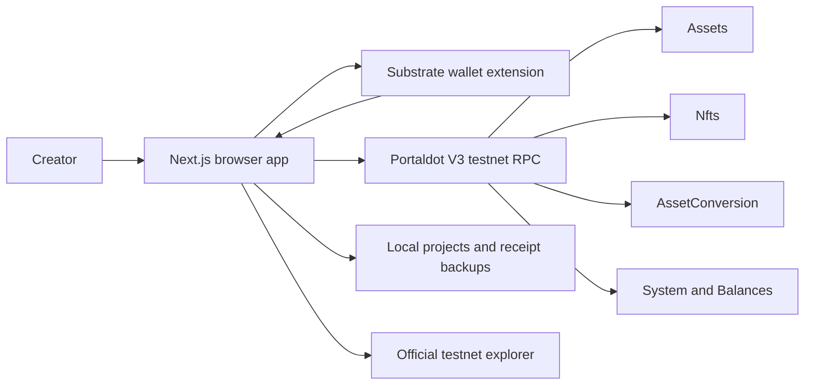

# Architecture

Updated October 25, 2026. PORTOVA is a browser-based Next.js application on Vercel, using Portaldot V3 testnet runtime pallets.

The October 25 update adds a shared wallet-operation guard to every signing screen, a common durable two-step NFT launch state machine, paginated storage discovery, prospective fee measurements and a pinned Creator Launch Health view in Studio. See REVIEW_FOLLOWUP.md for the validation scope and remaining owner wallet tests.

## Reads and writes

ChainProvider checks the genesis and runtime name before marking the connection live. It reads assets, collections, pools and heads. Pool positions use a pinned finalized block so reserves and LP issuance share a snapshot. Missing reads remain unavailable rather than invented balances or prices.

Assets manages fungible token creation/metadata/minting. Nfts manages collection creation, metadata and minting. AssetConversion handles pools, liquidity and swaps. Treasury uses Balances.transferKeepAlive. No new token, AMM or escrow contract is deployed.

Preflight checks the exact call, finalized account state, frozen funds, existential deposit, required deposits and a guarded fee budget. Swap quotes include minimum output and expire; a fresh post-sign check prevents a changed quote from broadcasting below the reviewed minimum.

Treasury binds its review to network, sender, wallet source, proceeds account, destination and amount. It validates before opening the signer and after signing, before broadcast. A signature can be discarded if the reviewed state changes.

## Wallet lifecycle

SubstrateWalletProvider enables an injected extension, reads authorized accounts and subscribes to account permission updates. Disconnect invalidates pending connection results. Reload reconnects only after a prior connection in that browser session. No private key is stored by Portova. EVM wallet support is separate; its 18-decimal tooling representation is not converted to native 14-decimal tPOT.

## Persistence and recovery

Projects and receipts are local browser records. TxProvider sits inside the chain and wallet providers, saves account/network/timestamp and inclusion hints, and recovers unresolved hashes from any route. It uses one bounded recovery page at a time, saves a backward cursor, and backs off between checks. A known inclusion block permits a direct old-block lookup. Imported outcome claims are reset to Unknown until RPC verification.

Finalized means matching system.ExtrinsicSuccess at the transaction's extrinsic index, in a canonical finalized block. Missing events, pruned history and incomplete RPC calls cannot establish success. JSON export/import supports moving receipts to another browser. The official explorer is independently linked; Portova has no full account-history indexer.

## Deployment

Next.js static/client routes are built by Vercel. Public RPC settings are in lib/network.ts. No environment file is required. Local environment files, Git metadata and build outputs are excluded from source uploads. See [deployment](DEPLOYMENT.md).
