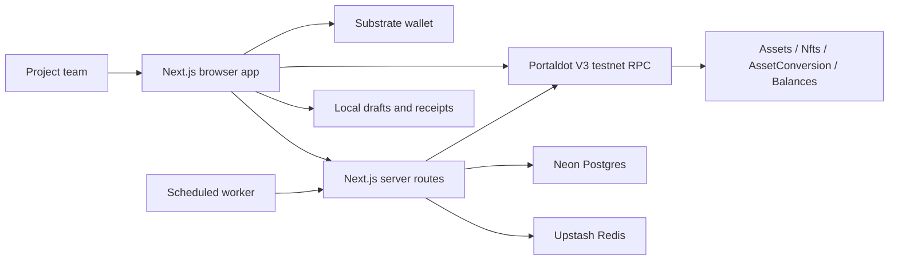

# Architecture

Portova is a Next.js application on Vercel. The browser signs native Portaldot V3 testnet calls through an injected Substrate wallet. Server endpoints provide authenticated workspaces, public discovery and operational jobs.

## Chain operations

ChainProvider verifies the configured genesis and reviewed runtime, subscribes to heads and discovers assets/collections/pools in independent pages. Finalized reads expose their block and completeness. Missing data remains unavailable rather than becoming a zero balance or empty result.

Native Assets handles fungible creation, metadata and minting. Nfts handles collections and items. AssetConversion handles pool setup, liquidity and swaps. Treasury uses Balances.transferKeepAlive. Portova deploys no custom contract.

Shared wallet-operation guards bind a call to its account, extension, network, runtime, connection and reviewed draft. Preflight checks finalized spendable balance, required deposits and guarded fees. Fresh swap quotes must cover the reviewed minimum before signing/broadcast. Durable NFT checkpoints let the same authorized account recover a two-stage launch.

## Persistence

Local project drafts, form state, NFT checkpoints and transaction receipts use browser storage with revision checks and cross-tab coordination. Storage failures are surfaced. Receipt recovery saves inclusion hints and bounded search checkpoints; imported success/account/charged-fee claims require chain verification.

Cloud commands use wallet-signed, origin/action/payload-bound challenges. Postgres consumes authorization and applies mutations atomically, retains idempotent results, checks revisions and enforces owner/member permissions. Cloud workspace access never grants chain authority.

Publishing is explicit. Public project reads exclude private and moderated-hidden records. Finalized role evidence is tied to a network and project revision; it is distinct from operator review or endorsement.

Redis stores short-lived finalized discovery pages and rate-limit counters. Signing reads remain direct. Required storage/rate-limiter failures stop cloud operations; browser discovery can fall back to RPC.

## Indexing and monitoring

The worker invokes authenticated, bounded server jobs. Postgres stores finalized checkpoints, object-associated events, monitored snapshots and alerts. Cursor/checkpoint comparisons protect concurrent jobs. These records describe their covered range; they are not a complete account or revenue ledger.

Monitoring compares supported roles/status/reserves between snapshots. Alerts describe observed changes, not their cause. The GitHub schedule is best effort and historical indexing remains behind; coverage and lag must be visible.

## Deployment boundaries

Production uses Postgres and Redis in Vercel's `iad1` region. Secrets stay in hosting/provider configuration. The production build verifies additive migrations before promotion; local/Preview builds do not migrate production. EVM tooling and optional disabled crypto billing are separate from native Substrate signing.

See [security](SECURITY_MODEL.md), [cloud configuration](CLOUD_PROJECTS.md), [deployment](DEPLOYMENT.md) and the [operations runbook](PRODUCTION_RUNBOOK.md).
